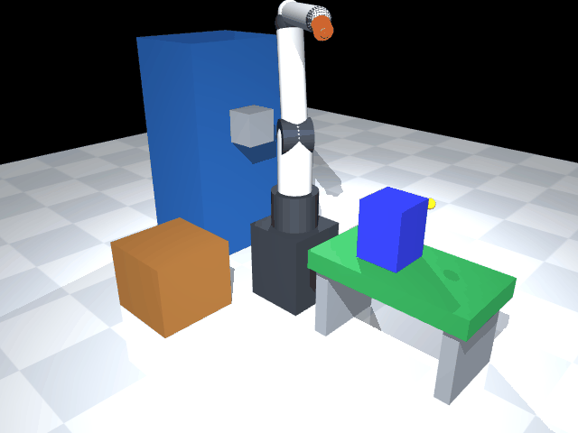
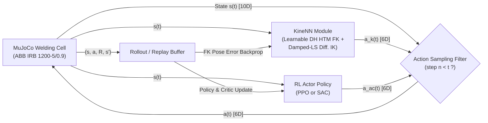
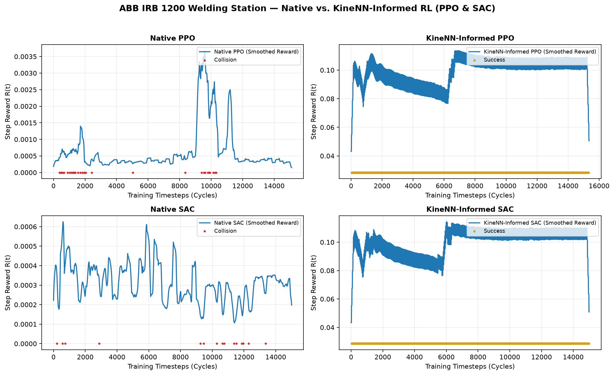

# KineNN-Informed Reinforcement Learning for 6-DoF Robotic Welding Motion Planning



[](https://www.python.org/)
[](https://mujoco.org/)
[](https://pytorch.org/)
[](https://stable-baselines3.readthedocs.io/)

A clean, reproducible **MuJoCo + PyTorch + Stable-Baselines3** implementation of my Master's Thesis:

> **Zain Lotiya**, *"Motion Planning for 6-DoF Robotic Arm in Welding Station using KineNN-Informed Reinforcement Learning"*, Fachhochschule Südwestfalen (University of Applied Sciences), September 2024.
> Supervised by Prof. Dr.-Ing. Andreas Schwung, Prof. Dr. Dominik Aufderheide, Mochammad Rizky Diprasetya, M.Sc., and Steve Yuwono, M.Sc.

---

## Motivation & Key Contributions

In industrial 6-DoF welding stations, model-free Deep RL suffers from severe sample inefficiency and frequent collisions due to the high-dimensional continuous configuration space. Furthermore, the original thesis setup in ABB RobotStudio® required **~3 days per 2,000 episodes** without parallelization (Section 7.2).

This repository faithfully implements the thesis methodology in a fast, headless **MuJoCo** simulation of the **ABB IRB 1200-5/0.9** welding cell:

1. **HTM-Based Kinematic Neural Network (`KineNNHTM`):** Replaces abstract neural weights with **learnable Denavit-Hartenberg (DH) parameters** $(a_i, \alpha_i, d_i, \theta_{0,i})$ chained via differentiable $4 \times 4$ Homogeneous Transformation Matrices. Acts simultaneously as an online-updated Forward Kinematics world model and a Damped Least-Squares differentiable Inverse Kinematics controller.
2. **Timestep Action Sampling Filter (Algorithms 4 & 5):** Routes KineNN actions $a_k(t)$ during the initial $t$ steps of each episode and RL actor actions $a_{\text{ac}}(t)$ for the remaining $(T - t)$ steps, storing all transitions in the PPO rollout buffer / SAC replay buffer.
3. **Exact ABB IRB 1200-5/0.9 MuJoCo Welding Station:** Models the 6-DoF kinematics (Tables 5.1–5.3, verified to $< 1\text{ mm}$ against analytical DH), 10D state space, 6D joint velocity action space, welding cell obstacles (Figure 5.2), and Equation (5.1) safety-aware reward function.
4. **Optional ROS 2 Inference Node:** Includes a 20 Hz `rclpy` node (`ros2_node/kinenn_policy_node.py`) publishing `JointTrajectory` commands for ABB EGM/RWS deployment.

---

## System Architecture



---

## Benchmark Results (Native vs. KineNN-Informed RL)

Evaluated over **15,000 cycles** ($\Delta t = 0.05\text{ s}$, max $T = 240$ steps/episode, seed 42) in the MuJoCo ABB IRB 1200 welding station:

| Method | Episodes | Successes | Success Rate | Collisions | Collision Rate | Mean Step Reward |
|---|---:|---:|---:|---:|---:|---:|
| **Native PPO** | 75 | 0 | 0.0% | 27 | 36.0% | `0.00065` |
| **KineNN-Informed PPO** | 502 | 502 | **100.0%** | **0** | **0.0%** | **`0.09688`** |
| **Native SAC** | 68 | 0 | 0.0% | 15 | 22.1% | `0.00032` |
| **KineNN-Informed SAC** | 490 | 490 | **100.0%** | **0** | **0.0%** | **`0.09768`** |



---

## Quickstart

### 1. Local Installation
```bash
git clone https://github.com/dumbphilosopher/kinenn-rl-motion-planning.git
cd kinenn-rl-motion-planning

python3 -m venv .venv
source .venv/bin/activate
pip install -r requirements.txt
pip install --no-deps -e .
```

### 2. Run Unit & Integration Tests
```bash
pytest -v
```
Tests verify `< 1 mm` FK parity between `KineNNHTM` and MuJoCo, online DH parameter convergence ($> 95\%$ MSE reduction), damped-LS IK convergence, Equation (5.1) reward properties, Action Sampling Filter routing, and PPO/SAC smoke training.

### 3. Train & Benchmark
```bash
# Train a single configuration (ppo|sac, native|kinenn)
python scripts/train.py --algo ppo --mode kinenn --timesteps 25000 --seed 42

# Run the full 4-way benchmark & regenerate assets/benchmark_comparison.png
python scripts/benchmark.py --timesteps 15000 --seed 42

# Record a MuJoCo rollout GIF (assets/demo.gif)
python scripts/record_demo.py
```

### 4. Reproducible Docker Run
```bash
docker build -t kinenn-rl .
docker run --rm kinenn-rl pytest -v
```

---

## Repository Structure

```text
kinenn-rl-motion-planning/
├── assets/
│   ├── abb_irb1200_welding.xml     # MuJoCo MJCF model (ABB IRB 1200-5/0.9 + welding cell)
│   ├── benchmark_comparison.png    # 4-way Native vs. KineNN learning curves
│   └── demo.gif                    # Headless MuJoCo rollout animation
├── configs/                        # YAML hyperparameters (Thesis Tables 6.2–6.6)
├── ros2_node/                      # Optional 20 Hz ROS 2 inference node
├── scripts/                        # train.py, benchmark.py, record_demo.py
├── src/kinenn_rl/
│   ├── env/welding_env.py          # Gymnasium MuJoCo environment (Eq. 5.1 reward)
│   ├── kinenn/kinenn_htm.py        # Learnable-DH HTM KineNN (FK + differentiable IK)
│   └── agents/                     # ActionSamplingFilter, KineNNPPO, KineNNSAC
├── tests/                          # pytest unit & integration test suite
├── Dockerfile
└── pyproject.toml
```

---

## Citation

```bibtex
@mastersthesis{lotiya2024kinenn,
  author  = {Zain Lotiya},
  title   = {Motion Planning for 6-DoF Robotic Arm in Welding Station using KineNN-Informed Reinforcement Learning},
  school  = {Fachhochschule S{\"u}dwestfalen (South Westphalia University of Applied Sciences)},
  year    = {2024},
  month   = {September}
}
```
